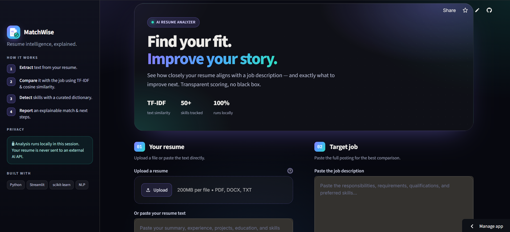
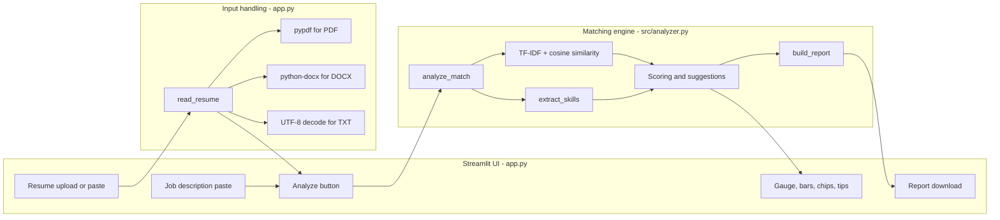
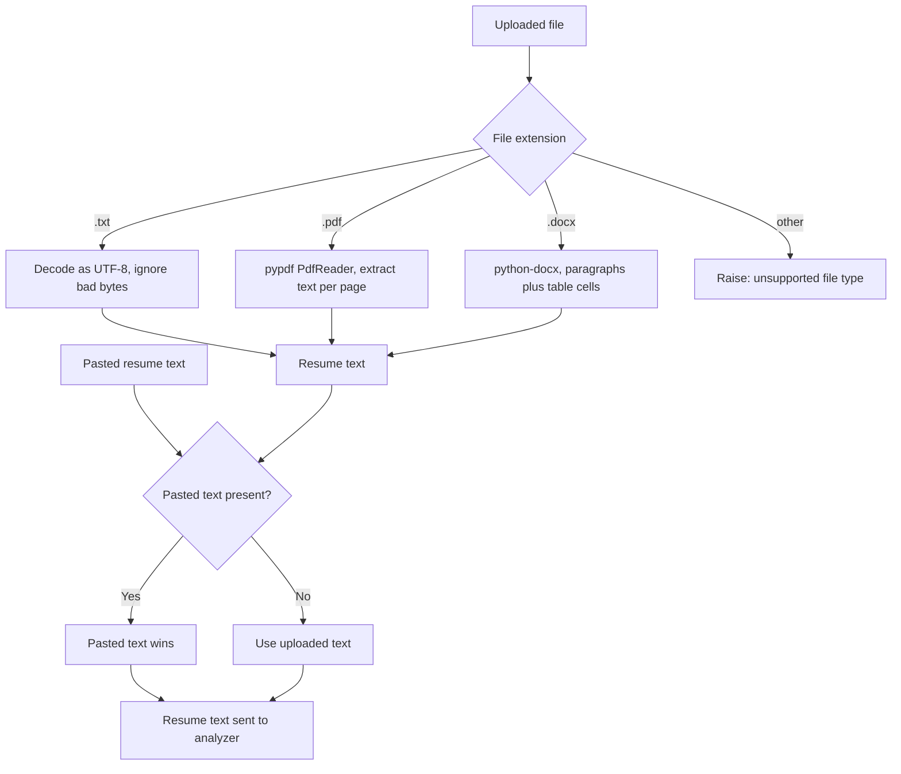
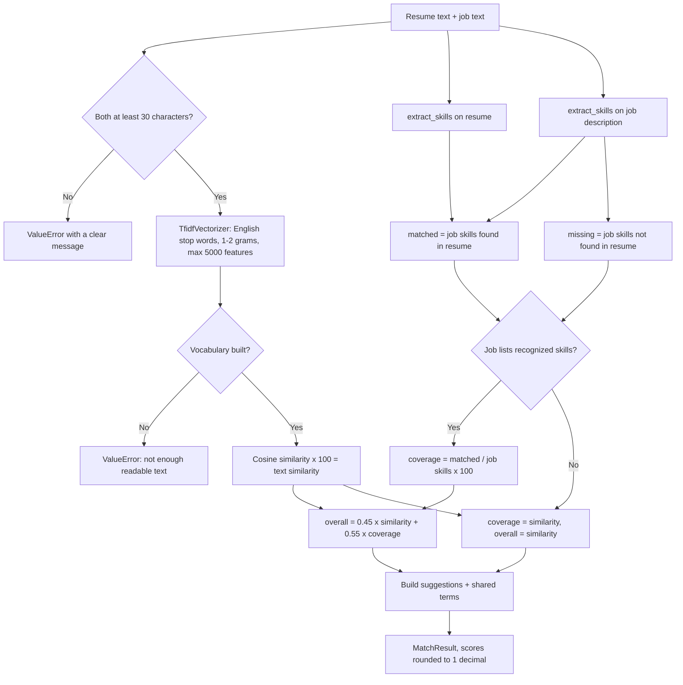
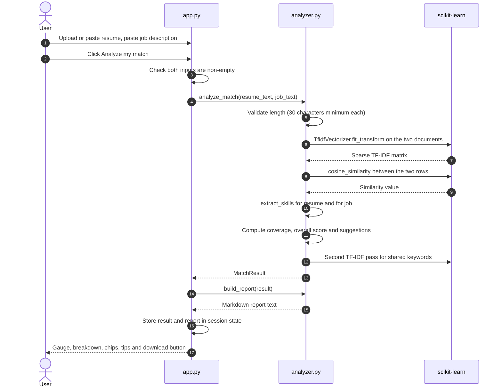
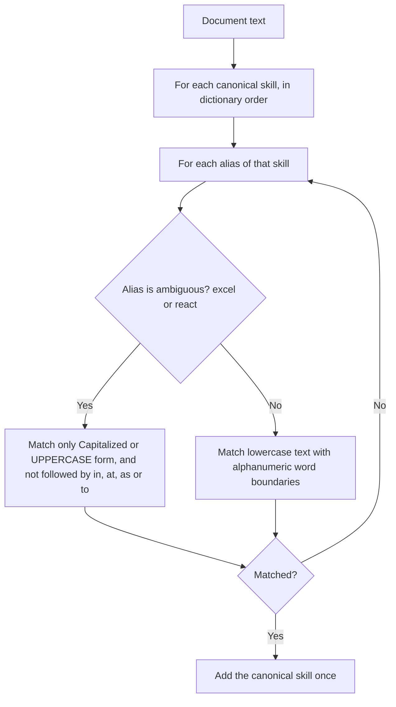
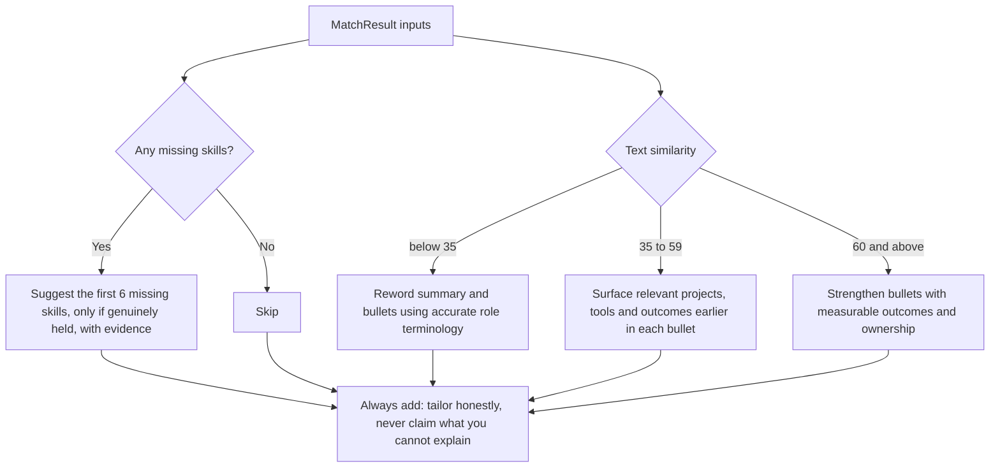

<div align="center">

# MatchWise

### Resume intelligence, explained. A transparent resume and job-description matcher with no black box.

**An explainable NLP application** that compares a resume against a job description, scores the match with
TF-IDF cosine similarity and a curated skills dictionary, shows exactly which skills matched or are missing,
and produces practical, honest improvement suggestions, all running **locally**, with **no external AI API**.

<br>

[](#quickstart)
[](#tech-stack)
[](#tech-stack)
[](#privacy--data-handling)
[](#why-matchwise)
[](#license)

<br>



<sub>Replace <code>docs/screenshot.png</code> with your own screenshot (or <code>docs/demo.gif</code>) - it renders automatically here and on GitHub.</sub>

<br><br>

[**Why MatchWise**](#why-matchwise) |
[**Features**](#features) |
[**Architecture**](#architecture) |
[**Quickstart**](#quickstart) |
[**Scoring**](#how-the-score-is-calculated) |
[**Design decisions**](#design-decisions--trade-offs) |
[**Roadmap**](#roadmap)

</div>

<br>

---

## Table of contents

- [Why MatchWise](#why-matchwise)
- [Features](#features)
- [How it works (30-second version)](#how-it-works-30-second-version)
- [Architecture](#architecture)
  - [System overview](#1-system-overview)
  - [Resume ingestion](#2-resume-ingestion)
  - [Analysis pipeline](#3-analysis-pipeline)
  - [Request lifecycle](#4-request-lifecycle)
  - [Skill extraction engine](#5-skill-extraction-engine)
  - [Suggestion engine](#6-suggestion-engine)
  - [Data model](#7-data-model)
  - [Presentation layer](#8-presentation-layer)
- [How the score is calculated](#how-the-score-is-calculated)
- [Tech stack](#tech-stack)
- [Quickstart](#quickstart)
- [Using the app](#using-the-app)
- [The skills dictionary](#the-skills-dictionary)
- [Configuration & tuning](#configuration--tuning)
- [Project structure](#project-structure)
- [Module reference](#module-reference)
- [Testing](#testing)
- [Design decisions & trade-offs](#design-decisions--trade-offs)
- [Privacy & data handling](#privacy--data-handling)
- [Limitations and honest interpretation](#limitations-and-honest-interpretation)
- [Deploying for free](#deploying-for-free)
- [Troubleshooting](#troubleshooting)
- [FAQ](#faq)
- [Talking points for interviews](#talking-points-for-interviews)
- [Roadmap](#roadmap)
- [Contributing](#contributing)
- [License](#license)

<br>

---

## Why MatchWise

Most "resume scanners" are opaque: they hand you a number with no explanation, ask you to upload personal
documents to someone else's server, or promise a "hiring prediction" that no simple tool can honestly make.
MatchWise is built to be **explainable, private, and honest**:

| Principle | What it means in practice |
|---|---|
| **Explainable, not a black box** | The overall score is split into two visible components, text similarity and skill coverage, with the exact weights shown in the UI and in the downloadable report. |
| **Runs locally** | Parsing, vectorization, scoring and skill detection all happen in the Python process on your machine. No resume text is sent to an external AI API. |
| **Evidence, not guesses** | Every skill chip comes from a transparent dictionary lookup you can read and extend in one file. |
| **Honest by design** | A missing skill means "not detected in the text you provided", never "this person lacks the skill". Suggestions explicitly warn against adding skills you cannot explain in an interview. |
| **Zero cost** | No API key, no paid service, no GPU. Just `pip install` and run. |

<br>

---

## Features

| # | Feature | What it actually does |
|---|---|---|
| 1 | **Multi-format resume input** | Upload a resume as **PDF, DOCX or TXT**, or paste its text directly. DOCX extraction includes table cells, not just paragraphs. |
| 2 | **TF-IDF cosine similarity** | Vectorizes both documents with unigrams and bigrams (English stop words removed) and measures the angle between them, reported as a percentage. |
| 3 | **Curated skill detection** | Detects **53 canonical skills** across data, ML, software, cloud, soft skills and electrical/embedded engineering, using aliases and word-boundary matching. |
| 4 | **Ambiguity-aware matching** | Words that are also ordinary English ("excel in a role", "react quickly") only count as tools when written as a tool name. |
| 5 | **Matched / missing skill analysis** | Compares the skills the job asks for against the skills found in the resume. |
| 6 | **Shared keyword extraction** | Surfaces the highest-signal words and two-word phrases that appear in both documents. |
| 7 | **Actionable suggestions** | Rule-based, tiered advice driven by missing skills and the similarity score. |
| 8 | **Downloadable Markdown report** | One click exports the full comparison as `matchwise_report.md`. |
| 9 | **Premium dark UI** | Animated score gauge, component bars, skill chips, responsive layout and reduced-motion support. |

### Also included

- **Sample data** - a fictional resume and a data-analyst job description so you can try the app in seconds.
- **Windows one-click launcher** - `launch_windows.bat` creates the virtual environment, installs dependencies and starts the app.
- **Automated tests** - unit tests for skill extraction, scoring, ambiguity handling and input validation.
- **Input validation** - clear error messages for empty, too-short or unreadable input.
- **Session persistence** - results stay on screen while you interact with the page.

<br>

---

## How it works (30-second version)

1. **Input** - you upload or paste a resume and paste a job description.
2. **Validate** - each document must contain at least 30 characters of real text.
3. **Vectorize** - both texts become TF-IDF vectors (unigrams + bigrams).
4. **Compare** - cosine similarity between the two vectors gives the **text similarity** score.
5. **Detect skills** - a dictionary of 53 skills and their aliases is matched against each document.
6. **Score** - `45% text similarity + 55% skill coverage` gives the **overall match** (or similarity alone when the job lists no recognized skills).
7. **Explain** - the UI shows the gauge, the breakdown, matched and missing skills, shared keywords and tailored suggestions, and lets you download the report.

<br>

---

## Architecture

### 1. System overview



The same flow as plain text, for terminals and quick reading:

```
   resume (PDF / DOCX / TXT / pasted)         job description (pasted)
                  │                                      │
                  ▼                                      │
        read_resume()  (app.py)                          │
        pypdf · python-docx · utf-8                      │
                  │                                      │
                  └──────────────────┬───────────────────┘
                                     ▼
                         analyze_match()  (src/analyzer.py)
                                     │
          ┌──────────────────────────┼──────────────────────────┐
          ▼                          ▼                          ▼
   TF-IDF vectors            extract_skills()            _top_shared_terms()
   cosine similarity         resume + job skills         shared keywords
          │                          │                          │
          └──────────────┬───────────┘                          │
                         ▼                                      │
            overall = 45% similarity + 55% coverage             │
            matched / missing skills, suggestions               │
                         │                                      │
                         └──────────────┬───────────────────────┘
                                        ▼
                                  MatchResult
                                        │
                      ┌─────────────────┴─────────────────┐
                      ▼                                   ▼
               Streamlit UI cards                  build_report()
          (gauge, bars, chips, tips)             matchwise_report.md
```

**Separation of concerns.** All NLP lives in `src/analyzer.py` and has **no Streamlit dependency**, so it is
unit-testable on its own and reusable from a CLI, notebook or API. `app.py` only handles file reading, layout
and rendering.

### 2. Resume ingestion



**Details worth knowing**

- **Pages and tables** - PDF text is joined page by page; DOCX tables are flattened row by row so skills listed in a table are not lost.
- **Precedence** - if both an upload and pasted text are present, the pasted text is used. This makes quick edits easy without re-uploading.
- **Friendly failures** - unreadable files surface an inline error rather than crashing the app.
- **Scanned PDFs** - image-only PDFs have no text layer; extraction returns little or nothing and the length check will flag it (see [Limitations](#limitations-and-honest-interpretation)).

### 3. Analysis pipeline



### 4. Request lifecycle



### 5. Skill extraction engine

Skills are defined in one dictionary, `SKILL_ALIASES`, mapping each **canonical name** to its **aliases**:

```python
"Machine Learning": ("machine learning", "ml"),
"Scikit-learn":     ("scikit-learn", "sklearn", "scikit learn"),
"Power BI":         ("power bi", "powerbi"),
"Google Cloud":     ("google cloud", "gcp"),
```



**Three rules keep matching accurate:**

1. **Word-boundary matching** - the pattern uses look-behind and look-ahead on alphanumerics, so `java` does **not** match inside `javascript`, and `sql` does not match inside `mysql`.
2. **Alias normalization** - `sklearn`, `scikit learn` and `scikit-learn` all resolve to one canonical **Scikit-learn** skill, so the same skill is never counted twice.
3. **Ambiguity guard** - `excel` and `react` are everyday English verbs. They only count when written as a tool name (`Excel`, `EXCEL`, `React`), and not in constructions like "excel in a role". This is covered by a dedicated unit test.

Output order follows dictionary order, which keeps results deterministic and easy to compare.

### 6. Suggestion engine

Suggestions are **rule-based and deterministic**, with no generated text that could invent claims.



Every result ends with an integrity reminder: tailor the resume to the role, but never add keywords or claim
experience you cannot discuss in an interview.

### 7. Data model

Everything the engine produces is returned in a single immutable-by-convention dataclass, `MatchResult`:

| Field | Type | Meaning |
|---|---|---|
| `similarity_score` | `float` | TF-IDF cosine similarity, 0 to 100, rounded to 1 decimal |
| `skill_coverage` | `float` | Share of job-description skills found in the resume, 0 to 100 |
| `overall_score` | `float` | Weighted final score, 0 to 100 |
| `matched_skills` | `List[str]` | Job skills also found in the resume |
| `missing_skills` | `List[str]` | Job skills not detected in the resume |
| `resume_skills` | `List[str]` | All dictionary skills detected in the resume |
| `job_skills` | `List[str]` | All dictionary skills detected in the job description |
| `top_shared_terms` | `List[str]` | Up to 8 high-signal words or phrases found in both documents |
| `suggestions` | `List[str]` | Ordered, human-readable improvement tips |

The UI and the Markdown report are both pure functions of this object, so there is no hidden state between the
engine and what you see on screen.

### 8. Presentation layer

`app.py` renders results with small, composable HTML/CSS helpers injected into Streamlit:

| Helper | Renders |
|---|---|
| `panel_head` | Numbered section headings for the input panels |
| `gauge_html` | Animated SVG score ring with a verdict badge |
| `bars_html` | The two weighted component bars (similarity 45%, coverage 55%) |
| `chips_card` | Skill and keyword chips with a count badge and an empty-state message |
| `tone` | Maps the overall score to a colour, label and message |

**Score tones**

| Overall score | Label | Colour intent |
|---|---|---|
| 75 and above | Strong match | Teal |
| 50 to 74 | Moderate match | Blue |
| Below 50 | Low match | Amber |

User-supplied strings (skill names, terms, suggestions) are passed through `html.escape` before being placed in
HTML. Motion respects `prefers-reduced-motion`, and the layout collapses to a single column on narrow screens.

<br>

---

## How the score is calculated

```
text similarity  = cosine_similarity(TF-IDF(resume), TF-IDF(job)) x 100

skill coverage   = matched recognized job skills / all recognized job skills x 100

overall score    = 0.45 x text similarity + 0.55 x skill coverage
```

If the job description contains **no recognized skills**, coverage is not forced to zero. The app falls back to
text similarity as the overall score, so the number is never artificially punished.

### Worked example (bundled demo data)

Using `sample_data/demo_resume.txt` against `sample_data/demo_job_description.txt`:

| Component | Value | Weight | Contribution |
|---|---|---|---|
| Text similarity | 30.9% | 45% | 13.9 |
| Skill coverage | 90.9% (10 of 11 job skills) | 55% | 50.0 |
| **Overall match** | **63.9%** | | **Moderate match** |

- **Matched (10):** Python, SQL, Data Analysis, Statistics, Power BI, Excel, Pandas, NumPy, Problem Solving, Communication
- **Not detected (1):** Tableau
- **Why similarity is lower than coverage:** the resume and the posting use different sentence wording even though they share almost every required skill. This is exactly the gap the two-part score is designed to expose.

> Your numbers may differ slightly across scikit-learn versions, but the method is identical.

<br>

---

## Tech stack

<div align="center">

| Layer | Choice | Why |
|---|---|---|
| UI | **Streamlit** | Fast Python-only interface, free hosting, no frontend build step |
| Text vectorization | **scikit-learn `TfidfVectorizer`** | Battle-tested TF-IDF with n-grams and stop-word handling |
| Similarity | **scikit-learn `cosine_similarity`** | Standard, fast, easy to explain |
| Skill detection | **Curated dictionary + regex** | Fully transparent and editable, no model to download |
| PDF parsing | **pypdf** | Pure-Python PDF text extraction |
| DOCX parsing | **python-docx** | Reads paragraphs and tables from Word files |
| Styling | **Custom CSS (Inter, JetBrains Mono)** | A polished dark interface inside Streamlit |
| Tests | **`unittest`** | Zero extra dependencies |

</div>

**Dependencies (`requirements.txt`)**

```text
streamlit>=1.50.0
scikit-learn>=1.5.0
pypdf>=5.0.0
python-docx>=1.1.2
```

<br>

---

## Quickstart

**Prerequisites:** Python 3.10 or newer. No API keys, accounts or GPUs required.

### Windows (one click)

Double-click **`launch_windows.bat`**. It will:

1. Check that the Python launcher (`py`) is available.
2. Create `.venv` if it does not exist.
3. Upgrade `pip` and install `requirements.txt`.
4. Start the app with `python -m streamlit run app.py`.

### Windows (manual, PowerShell)

```powershell
git clone https://github.com/abhishek5703/matchwise-resume-analyzer.git
cd matchwise-resume-analyzer

py -m venv .venv
.\.venv\Scripts\Activate.ps1

python -m pip install -r requirements.txt
streamlit run app.py
```

### macOS / Linux

```bash
git clone https://github.com/abhishek5703/matchwise-resume-analyzer.git
cd matchwise-resume-analyzer

python3 -m venv .venv
source .venv/bin/activate

python -m pip install -r requirements.txt
streamlit run app.py
```

Open the URL Streamlit prints (usually `http://localhost:8501`).

<br>

---

## Using the app

1. **Add your resume** - upload a PDF, DOCX or TXT, or paste the text into the box.
2. **Add the job description** - paste the full posting, especially the requirements section.
3. **Analyze** - click **Analyze my match**.
4. **Read the report** - check the overall gauge, the two-part breakdown, matched and missing skills, shared keywords and suggestions.
5. **Download** - save the Markdown report for your records or to share with a mentor.

### Try the included demo

Use `sample_data/demo_resume.txt` as the resume and `sample_data/demo_job_description.txt` as the job
description. The sample candidate is fictional. You should see a moderate match with one missing skill
(Tableau).

### What the report contains

The exported `matchwise_report.md` includes:

- Match overview (overall, text similarity, skill coverage)
- Skills detected in the resume and in the job description
- Matched skills and skills not detected
- Shared terms
- Suggested improvements
- A plain-language description of the scoring method and a disclaimer that it is informational, not a hiring prediction

<br>

---

## The skills dictionary

53 canonical skills grouped here by domain (the dictionary itself is a single flat mapping):

| Domain | Skills |
|---|---|
| **Programming** | Python, C++, C, C#, Java, SQL, JavaScript |
| **Machine learning and AI** | Machine Learning, Deep Learning, Natural Language Processing, Generative AI, Scikit-learn, TensorFlow, PyTorch |
| **Data and analytics** | Data Analysis, Statistics, Power BI, Tableau, Excel, Pandas, NumPy, Matplotlib |
| **Web and databases** | HTML, CSS, React, Node.js, REST APIs, MongoDB, MySQL, PostgreSQL, Streamlit |
| **Cloud and tooling** | Git, Docker, Linux, AWS, Azure, Google Cloud |
| **Professional skills** | Problem Solving, Communication, Leadership, Project Management |
| **Electrical and embedded** | Power Systems, MATLAB, Simulink, Embedded Systems, Microcontrollers, RTOS, UART, SPI, I2C, Power Electronics, Electrical Machines, Renewable Energy |

### Adding or editing a skill

Open `src/analyzer.py` and add an entry to `SKILL_ALIASES`:

```python
SKILL_ALIASES = {
    # ...existing skills...
    "Kubernetes": ("kubernetes", "k8s"),
    "FastAPI":    ("fastapi", "fast api"),
}
```

Guidelines:

- Use a clear **canonical name** as the key and **lowercase aliases** in the tuple.
- Include common abbreviations and spelling variants (`gcp`, `sklearn`, `nodejs`).
- If an alias is also an everyday English word, add it to `AMBIGUOUS_ALIASES` so it only matches when capitalized as a tool name.
- Add a test in `tests/test_analyzer.py` for any new ambiguity rule.

<br>

---

## Configuration & tuning

MatchWise has no config file or environment variables. The tunable values live as clearly named constants and
literals in `src/analyzer.py` and `app.py`:

| Setting | Default | Where | Effect |
|---|---|---|---|
| Similarity weight | `0.45` | `analyze_match` | Share of the overall score from TF-IDF text similarity |
| Coverage weight | `0.55` | `analyze_match` | Share of the overall score from skill coverage |
| Minimum input length | `30` characters | `analyze_match` | Shorter resume or job text is rejected |
| TF-IDF `ngram_range` | `(1, 2)` | `analyze_match` | Unigrams and bigrams |
| TF-IDF `max_features` (similarity) | `5000` | `analyze_match` | Vocabulary cap for the main comparison |
| TF-IDF `max_features` (shared terms) | `3000` | `_top_shared_terms` | Vocabulary cap for keyword extraction |
| Shared terms `limit` | `8` | `_top_shared_terms` | How many shared keywords are shown |
| Suggestion tiers | `35` / `60` | `analyze_match` | Similarity cut-offs for the three advice levels |
| Missing skills in tip | `6` | `analyze_match` | How many missing skills are named in the suggestion |
| Score tones | `75` / `50` | `tone` in `app.py` | Strong / Moderate / Low badge thresholds |
| `AMBIGUOUS_ALIASES` | `excel`, `react` | `analyzer.py` | Aliases that require tool-name capitalization |

### Tuning cookbook

| Goal | Change |
|---|---|
| Reward exact skill overlap more | Raise the coverage weight and lower the similarity weight (keep them summing to 1.0) |
| Reward natural-language alignment more | Do the reverse |
| Catch more tools and technologies | Add entries to `SKILL_ALIASES` |
| Stop a common word being counted as a skill | Add it to `AMBIGUOUS_ALIASES` |
| Show more shared keywords | Raise `limit` in `_top_shared_terms` |
| Make "Strong match" harder to earn | Raise the `75` threshold in `tone` |

<br>

---

## Project structure

```text
matchwise-resume-analyzer/
├── app.py                    # Streamlit interface, CSS design system, file reading, result rendering
├── src/
│   ├── __init__.py
│   └── analyzer.py           # Skills dictionary, TF-IDF scoring, suggestions, report builder
├── tests/
│   └── test_analyzer.py      # Unit tests for the matching engine
├── sample_data/
│   ├── demo_resume.txt             # Fictional candidate resume
│   └── demo_job_description.txt    # Entry-level data analyst posting
├── assets/
│   └── favicon.png           # Browser tab icon used by st.set_page_config
├── docs/
│   └── screenshot.png        # Drop your app screenshot here
├── requirements.txt
├── launch_windows.bat        # One-click Windows setup and launch
├── README.md
└── .gitignore                # Ignores .venv, __pycache__, secrets.toml, .DS_Store
```

<br>

---

## Module reference

| Module | Responsibility | Depends on |
|---|---|---|
| **`app.py`** | Page config and CSS, sidebar, file reading (`read_resume`), input panels, calling the engine, rendering the gauge, bars, chips, suggestions and download button. | `src.analyzer`, `streamlit`, `pypdf`, `python-docx` |
| **`src/analyzer.py`** | `SKILL_ALIASES`, `_contains_phrase`, `extract_skills`, `_top_shared_terms`, `analyze_match`, `build_report` and the `MatchResult` dataclass. Pure Python with no UI code. | `scikit-learn`, `re`, `dataclasses` |
| **`tests/test_analyzer.py`** | Verifies skill aliases, scoring bounds, matched and missing logic, ambiguity handling, shared phrases and input validation. | `unittest`, `src.analyzer` |
| **`launch_windows.bat`** | Creates the virtual environment, installs dependencies and starts Streamlit. | Python launcher (`py`) |

### Public engine API

```python
from src.analyzer import analyze_match, extract_skills, build_report

result = analyze_match(resume_text, job_text)   # -> MatchResult
print(result.overall_score, result.missing_skills)

skills = extract_skills("Python, SQL and Power BI")   # -> ["Python", "SQL", "Power BI"]
markdown = build_report(result)                       # -> str
```

Because the engine is UI-independent, it can be dropped into a CLI, a notebook, a FastAPI endpoint or a batch
script without changes.

<br>

---

## Testing

```bash
python -m unittest discover -s tests -v
```

| Test | What it protects |
|---|---|
| `test_extract_skills_aliases` | Aliases such as `PowerBI` and `data analytics` map to the right canonical skills |
| `test_match_scores_and_missing_skills` | Scores stay within 0 to 100 and matched or missing skills are correct |
| `test_ambiguous_words_not_counted_as_skills` | "excel in teams" and "react quickly" are not treated as tools, while `Excel` in a skills list is |
| `test_plain_communication_detected` | Soft-skill detection works on plain lowercase text |
| `test_shared_terms_include_phrases` | Shared keywords include multi-word phrases, not only single words |
| `test_rejects_too_short_text` | Too-short input raises a clear `ValueError` |

Expected result: **6 tests, all passing.**

<br>

---

## Design decisions & trade-offs

| Decision | Alternative | Why this way |
|---|---|---|
| **TF-IDF + cosine similarity** | Sentence embeddings or an LLM | Fast, dependency-light, fully explainable and easy to defend in an interview. Embeddings are listed on the roadmap as a comparison baseline. |
| **Curated skills dictionary** | Named-entity recognition or a learned model | Transparent and editable, with predictable behaviour and no model download. |
| **Two-part weighted score** | A single similarity number | Similarity alone is noisy; skill coverage alone ignores context. Showing both exposes why a score is high or low. |
| **45% / 55% weighting** | Equal weights | Hard requirements (skills) deserve slightly more weight than wording overlap. The weights are visible everywhere. |
| **Fallback to similarity when no skills are found** | Treat coverage as 0% | A job post in a domain outside the dictionary should not be punished with a fake zero. |
| **Ambiguity guard for `excel` and `react`** | Plain substring match | Prevents false positives from ordinary English verbs. |
| **Rule-based suggestions** | LLM-generated advice | Deterministic, free, private and incapable of inventing experience for the user. |
| **Engine separated from UI** | Logic inside `app.py` | Enables unit tests and reuse in other front ends. |
| **Local-only processing** | Hosted AI API | Resumes are sensitive; nothing leaves the machine for analysis. |

**A note on IDF.** The vectorizer is fitted on just **two** documents, the resume and the job description. With
a corpus that small, inverse document frequency acts as a mild re-weighting (terms in only one document weigh
slightly more than terms in both) rather than a true corpus-wide rarity signal. The score is best read as
"how similar is the wording", which is exactly how the UI describes it. A larger reference corpus is a natural
upgrade.

<br>

---

## Privacy & data handling

| Stage | Where it runs | What leaves your machine? |
|---|---|---|
| File reading (PDF, DOCX, TXT) | Local Python process | Nothing |
| TF-IDF and cosine similarity | Local (`scikit-learn`) | Nothing |
| Skill detection | Local (regex over a dictionary) | Nothing |
| Report generation | Local | Nothing |
| Page fonts (Inter, JetBrains Mono) | Browser, from Google Fonts | A standard font request, **not your resume text** |

- **No external AI API** is called and no API key exists in the project.
- **Nothing is written to disk** by the app: results live in the Streamlit session and the report is generated in memory for download.
- **If you deploy the app publicly**, resume text is processed on the server that hosts it. For maximum privacy, run it locally.
- `.streamlit/secrets.toml` is git-ignored as a safeguard, although this app does not currently need secrets.

<br>

---

## Limitations and honest interpretation

- This is a **lightweight NLP matching aid**, not a hiring prediction system and not a recruiter or ATS score.
- **TF-IDF measures wording overlap**; it does not understand context, seniority or meaning the way a modern language model would.
- The **skill detector can miss** synonyms, abbreviations and skills that are not yet in the dictionary.
- A **missing skill** means "not detected in the provided resume text", not proof that a person lacks that skill.
- **Scanned or image-only PDFs** contain no text layer, so little or nothing is extracted. Use a text-based PDF, DOCX or pasted text.
- Some aliases are intentionally broad (for example `git` also matches `github`, and `analytics` counts toward Data Analysis).
- Never add a skill or experience to a resume unless it is genuine and you can explain it in an interview.

<br>

---

## Deploying for free

1. Push the repository to GitHub (the `.gitignore` already excludes `.venv`).
2. Deploy on [Streamlit Community Cloud](https://streamlit.io/cloud) and point it at `app.py`.
3. No secrets, API keys or extra configuration are needed.

Make sure `assets/favicon.png` is committed, because the app loads it at startup. Remember that a hosted
deployment processes pasted and uploaded resumes on the host's server.

<br>

---

## Troubleshooting

| Problem | Fix |
|---|---|
| "Python launcher was not found" from `launch_windows.bat` | Install Python 3.10+ from python.org and tick the option to install the `py` launcher. |
| App fails at startup with an image or icon error | Confirm `assets/favicon.png` exists. `app.py` loads it in `st.set_page_config`. |
| `width="stretch"` or similar argument errors | Upgrade Streamlit: `pip install -U "streamlit>=1.50.0"`. |
| PowerShell blocks `Activate.ps1` | Run `Set-ExecutionPolicy -Scope CurrentUser RemoteSigned`, or use `launch_windows.bat`. |
| "Could not read this file" | The file may be corrupted, password-protected or an unsupported type. Try a different export, or paste the text. |
| PDF loads but the word count is tiny | The PDF is probably scanned images. Export a text-based PDF or paste the text. |
| "Please provide a longer resume" | Each input needs at least 30 characters of readable text. |
| Skills you have are shown as missing | They may not be in the dictionary or are written differently. Add aliases in `SKILL_ALIASES`. |
| Dark theme looks plain or fonts differ | Fonts load from Google Fonts. Offline, the app falls back to system fonts. |

<br>

---

## FAQ

<details>
<summary><b>Does it use ChatGPT or any other AI service?</b></summary>
<br>
No. It uses classic, transparent NLP (TF-IDF and cosine similarity) plus a skills dictionary, entirely on your machine.
</details>

<details>
<summary><b>Is the score what a recruiter or ATS would give me?</b></summary>
<br>
No. It is an educational estimate of wording and skill overlap. Real hiring decisions depend on far more than keyword alignment.
</details>

<details>
<summary><b>Why is my similarity low but my skill coverage high?</b></summary>
<br>
You likely have the right skills but describe them in different words than the posting. Reword your bullets using accurate terminology from the role, without claiming anything untrue.
</details>

<details>
<summary><b>Can I use it for non-technical jobs?</b></summary>
<br>
Text similarity works for any role, but skill detection only knows the 53 dictionary skills. For other fields, extend <code>SKILL_ALIASES</code> or rely on the similarity and shared-keyword views.
</details>

<details>
<summary><b>Can I add my own skills?</b></summary>
<br>
Yes. Add an entry to <code>SKILL_ALIASES</code> in <code>src/analyzer.py</code>; see <a href="#the-skills-dictionary">The skills dictionary</a>.
</details>

<details>
<summary><b>Which file types are supported?</b></summary>
<br>
PDF, DOCX and TXT uploads, or pasted text. The job description is always pasted.
</details>

<br>

---


<br>

---

## Roadmap

- [ ] Add semantic embeddings (for example, Sentence Transformers) and compare them against the TF-IDF baseline
- [ ] Larger, editable skill taxonomy for specific job families, loaded from a JSON or YAML file
- [ ] Bullet-level feedback that highlights the resume evidence for each matched skill
- [ ] Small labelled evaluation set with precision and recall for skill extraction
- [ ] Section-aware parsing (separate weighting for Skills, Experience and Projects)
- [ ] OCR support for scanned PDFs
- [ ] Side-by-side comparison of one resume against several job descriptions
- [ ] Deploy the app and add a short demo video to this README

<br>

---

## Contributing

Contributions, issues and ideas are welcome.

1. Fork the repository and create a feature branch.
2. Keep matching logic in `src/analyzer.py` and UI code in `app.py`.
3. Add or update tests in `tests/test_analyzer.py` for any behaviour change, and run `python -m unittest discover -s tests -v`.
4. Open a pull request describing the change and, for scoring changes, how it affected results on the sample data.

<br>

---

## License

MIT - use it, fork it, put it in your portfolio.

<div align="center">
<br>
<sub>Built with TF-IDF, a curated skills dictionary, and zero external AI calls.</sub>
<br><br>
<b>If MatchWise helped you, consider leaving a star</b>
</div>